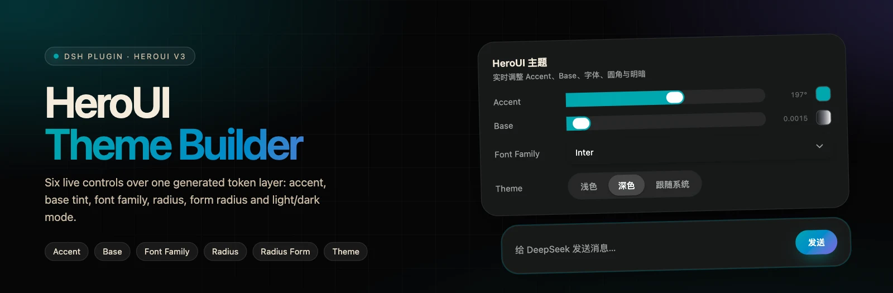
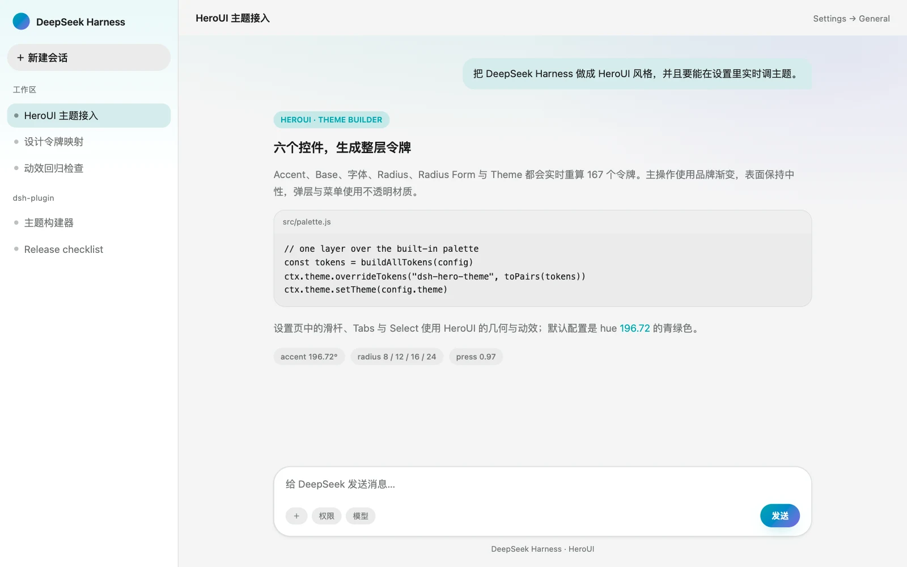
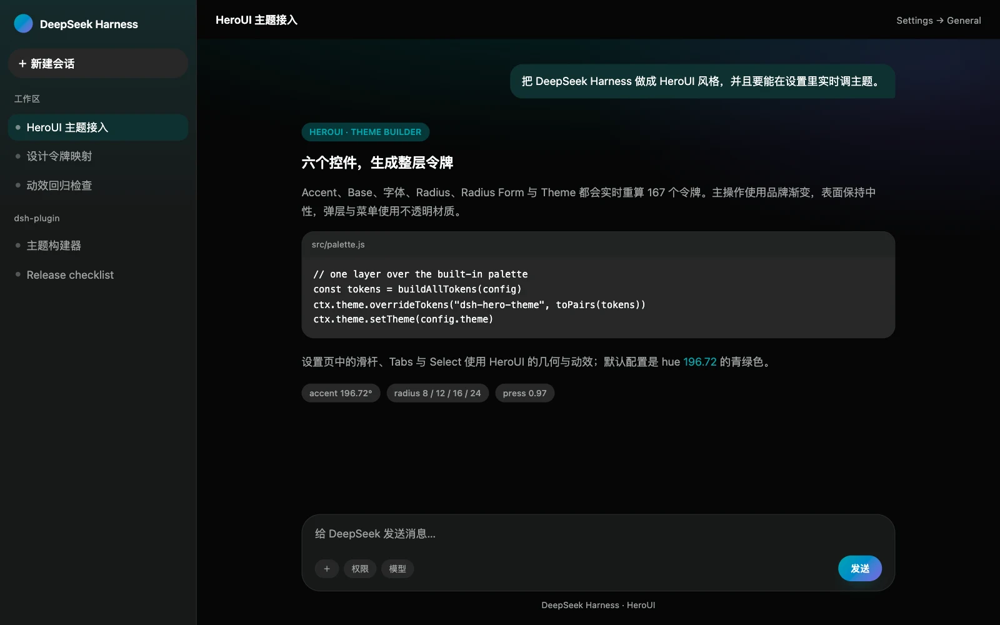
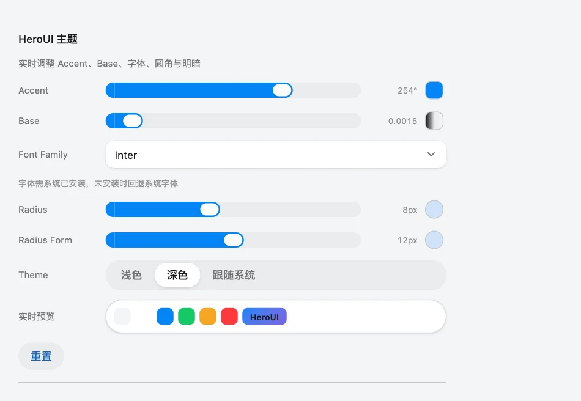
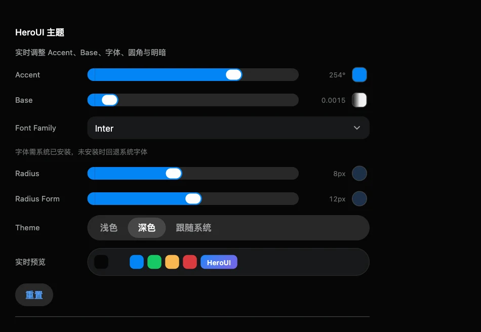
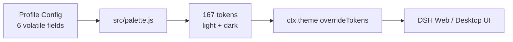

<p align="center">
  
</p>

<p align="center">
  <a href="https://github.com/Lhy723/dsh-hero-theme/stargazers"></a>
  
  
  
  
  <a href="https://github.com/Lhy723/dsh-hero-theme/pulls"></a>
</p>

<h1 align="center">dsh-hero-theme</h1>

<p align="center">
  A <b>HeroUI v3 theme builder</b> for DeepSeek Harness Web and the embedded Desktop workspace.<br>
  Six live controls regenerate the complete DSH token layer — no rebuild, no profile restart.
</p>

<p align="center">
  <b>English</b> · <a href="README.zh.md">中文</a>
</p>

## Preview

<p align="center">
  
  
</p>

<sub align="center">Preview renders of the generated light and dark palettes in a representative DSH layout.</sub>

## Highlights

| | |
| --- | --- |
| **Six live controls** | Accent hue, Base chroma, Font Family, Radius, Radius Form, Light / Dark / System. |
| **167 tokens × 2 schemes** | Every alias, specific, Shiki, radius, shadow and timing token is regenerated from the config. |
| **HeroUI builder formulas** | Accent `oklch(62.04% 0.195 hue)`, neutral chroma scaling, semantic hue rotation, radius scale. |
| **Component geometry** | HeroUI Slider, Tabs, Select, Button, MenuSurface, Dialog and Tooltip geometry plus enter/exit motion. |
| **No rebuild loop** | Changes apply through one `ctx.theme.overrideTokens()` layer and persist to the profile Cordis patch. |
| **Reduced motion aware** | All added transitions and enter/exit animations stop under `prefers-reduced-motion: reduce`. |

## Theme builder

<p align="center">
  
  
</p>

<sub align="center">Settings → General → HeroUI theme. The sliders, Tabs and Select are HeroUI-styled controls.</sub>

| Control | Range | Default | What it changes |
| --- | --- | --- | --- |
| Accent | hue `0–360` | `196.72` | Accent `oklch(62.04% 0.195 hue)`, focus ring, gradient start |
| Base | chroma `0–0.02` | `0.0015` | Chroma of every neutral (background, surfaces, text, borders) |
| Font Family | Inter / System UI / Geist / Manrope / IBM Plex Sans / JetBrains Mono | Inter | `--dsw-font-family` and the brand stack |
| Radius | `0–1.25rem` | `0.5rem` (8px) | HeroUI radius scale and card radius (`3×`) |
| Radius Form | `0–1.5rem` | `0.75rem` (12px) | Inputs and form fields |
| Theme | Light / Dark / System | Dark | Base color scheme and `ctx.theme.setTheme()` |

The default accent is the HeroUI builder's teal at hue `196.72`; the secondary gradient color is generated 88° around the wheel. Fonts must be installed locally — the stack falls back to System UI.

## Generated palette

The generator mirrors the HeroUI v3 theme builder formulas:

| Token | Light | Dark |
| --- | --- | --- |
| background | `oklch(97.02% base hue)` | `oklch(12.00% base hue)` |
| foreground | `oklch(21.03% base hue)` | `oklch(99.11% base hue)` |
| surface | `oklch(100% 0.53×base hue)` | `oklch(21.03% 2×base hue)` |
| surface-secondary | `oklch(95.24% 0.8×base hue)` | `oklch(25.70% 1.53×base hue)` |
| accent | `oklch(62.04% 0.195 hue)` | same |
| success / warning / danger | HeroUI semantic hues, rotated by `12%` of the accent hue delta | same |

Radii: HeroUI component tokens use `3×` (cards), `2.5×` (tabs), `2× + 6px` (popovers) and a separate form radius. DSH's semantic scale is `xs 0.5× / sm 1× / md 1.5× / lg 2× / xl-panel 3×`, so native rows, menus and cards keep their intended proportions.

## Brand layer

On top of the generated tokens, `src/hero.css` adds the recognizable HeroUI details:

- **Gradient primary actions** — accent → `accent + 88°` with a soft glow.
- **Aurora wash** — accent/violet gradients on the conversation canvas and sidebar.
- **HeroUI surfaces** — composer and dialogs use the card radius; Dropdown/Select menu popovers use the 22px dropdown radius. Bubbles, selected sessions, menus and overlays never show the page through.
- **HeroUI controls** — 36px secondary buttons with the 0.97 press scale, a sliding-indicator Tabs switch for the theme, and a Select with a rotating chevron, 150ms scale/fade popover, 100ms exit and a stroke-drawn check.
- **HeroUI sliders** — 20px track with 12px end caps, a 28×20 accent thumb and a 24×16 inner face; an invisible native range input keeps pointer, keyboard and aria semantics.
- **Motion** — button `scale(0.97)`, popover/dialog/tooltip enter scales, 2s skeleton shimmer, user-message entrance; all disabled under `prefers-reduced-motion`.

## Install

```sh
# DSH Web
dsh plugin --profile web add dsh-hero-theme
# DSH Desktop
dsh plugin --profile desktop add dsh-hero-theme
```

Or install manually into the Web profile:

```sh
cd ~/.dsh/profiles/web
pnpm add dsh-hero-theme
```

Add `"dsh-hero-theme"` to `dsh.profile.bundles` in that profile's
`package.json` and restart the profile.

Then open **Settings → General → HeroUI theme**. Drag Accent/Base/Radius/Radius Form, choose a font and theme; every change applies immediately and is saved into the active profile's Cordis patch. **Reset** returns to the builder defaults.

## How it works



1. The Host declares six volatile Config fields: `theme`, `accentHue`, `baseChroma`, `fontFamily`, `radius`, `fieldRadius`.
2. The browser half reads that config and calls `buildAllTokens()` to generate both light and dark palettes.
3. The result is applied as one `ctx.theme.overrideTokens()` layer; `ctx.theme.setTheme(config.theme)` switches the built-in base scheme.
4. The settings row writes each field through ConfigForms (range writes are debounced by 180ms).
5. An external change to the built-in Appearance row is adopted into `theme`, so reloads keep the same appearance.

The override disposer is deferred with `queueMicrotask` so removing the layer never re-enters the `theme/change` dispatch.

## Platform compatibility

`dsh-hero-theme` is a Web client plugin (`dsh.client.platform: "web"`). DSH Desktop embeds the Web application, so the theme applies there through the Web client plugin loader; Desktop has its own profile. This package styles the embedded workspace only — it does not add native menu, tray, or window-shell UI.

Requires DSH `^0.2.2-rc.1`.

## Develop

```sh
npm run build   # regenerates lib/client.js + lib/index.js
npm run check   # build, syntax, API contract, palette and contrast checks
```

`src/palette.js` is the single source of truth for colors, radii and fonts. It is injected into the client bundle at build time; its default output is covered by contrast and token-set checks.

## Repository layout

```
dsh-hero-theme/
├── package.json          # dsh.bundle.patch + dsh.client manifest
├── cordis.patch.yml      # loader entry insert (id: dsh-hero-theme)
├── src/
│   ├── index.js          # Host Config schema (six volatile fields)
│   ├── palette.js        # HeroUI v3 palette generator
│   ├── client.tpl.js     # browser half: builder row + token application
│   └── hero.css          # brand gradient, aurora, opaque surfaces, motion
├── scripts/
│   ├── build.mjs         # zero-dependency build
│   └── check-compat.mjs  # DSH API, palette, contrast and CSS contract
├── .github/asset/        # README banner and preview renders
├── LICENSES/             # Apache-2.0 text for the HeroUI-derived material
└── lib/                  # generated artifacts (rebuilt on install/pack)
```

## Attribution and license

The plugin code is MIT-licensed (see [LICENSE](LICENSE)). Design tokens and
interaction values are derived from **HeroUI**, which is Apache-2.0 licensed;
see [NOTICE](NOTICE) and [LICENSES/Apache-2.0.txt](LICENSES/Apache-2.0.txt).

This is an independent theme. It is not affiliated with or endorsed by HeroUI.
