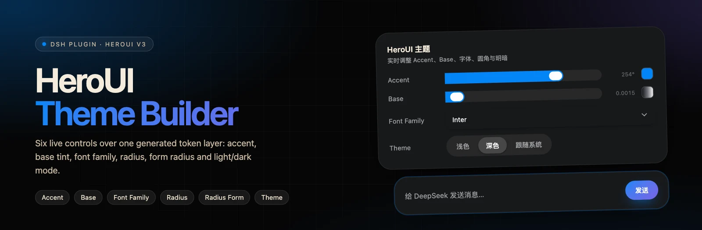
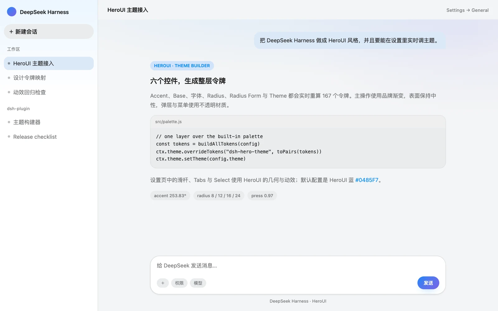
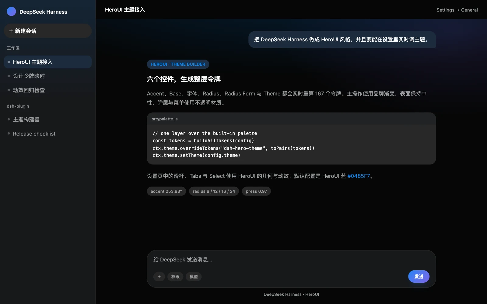
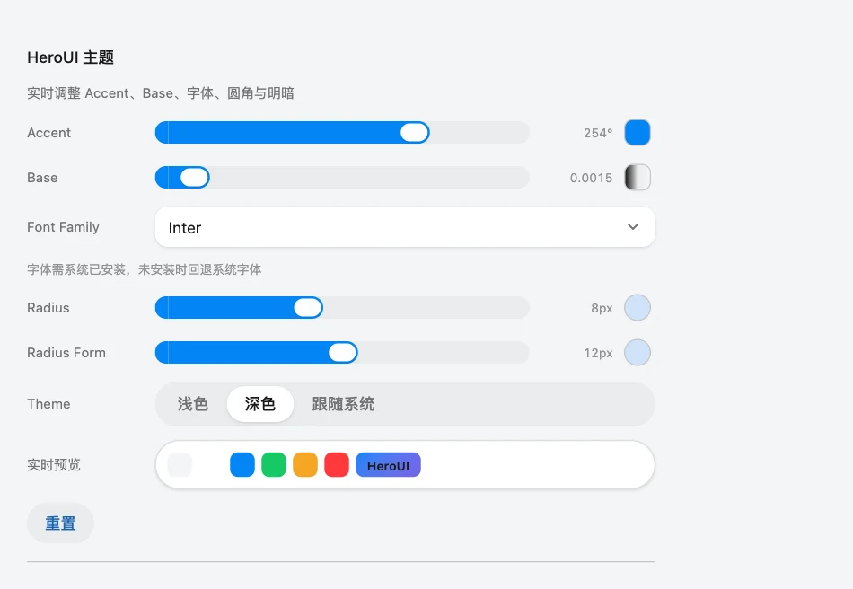
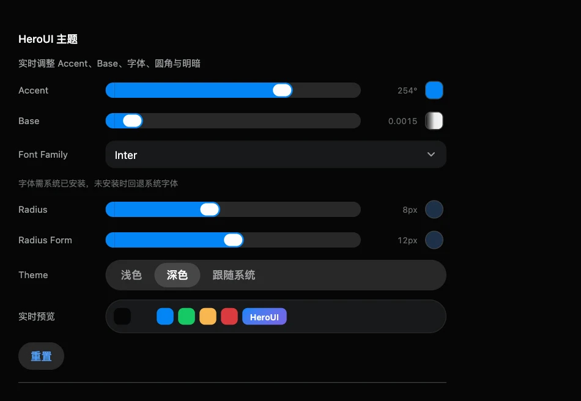
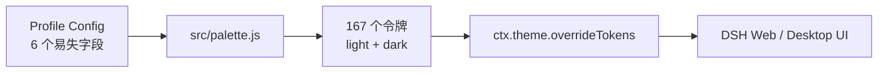

<p align="center">
  
</p>

<p align="center">
  <a href="https://github.com/Lhy723/dsh-hero-theme/stargazers"></a>
  <a href="https://www.npmjs.com/package/dsh-hero-theme"></a>
  <a href="https://www.npmjs.com/package/dsh-hero-theme"></a>
  
  
  
  
  <a href="https://github.com/Lhy723/dsh-hero-theme/pulls"></a>
</p>

<h1 align="center">dsh-hero-theme</h1>

<p align="center">
  <b>DeepSeek Harness Web 与内嵌桌面工作区</b>的 <b>HeroUI v3 主题构建器</b>。<br>
  实时控件与品牌预设重新生成完整的 DSH 令牌层 —— 不用重新构建，也不用重启 profile。
</p>

<p align="center">
  <a href="README.md">English</a> · <b>中文</b>
</p>

## 预览

<p align="center">
  
  
</p>

<p align="center"><sub>基于生成令牌的浅色 / 深色预览，使用代表性 DSH 布局渲染。</sub></p>

## 特性

| | |
| --- | --- |
| **七个实时控件** | Accent（色相 / 彩度 / 亮度 + Vibrant）、Base 彩度、Font Family、Radius、Radius Form、Theme 预设、浅色 / 深色 / 跟随系统。 |
| **167 个令牌 × 2 套方案** | 所有 alias、specific、Shiki、圆角、阴影与时长令牌都由配置重新生成。 |
| **HeroUI 构建器公式** | Accent `oklch(62.04% 0.195 hue)`、中性色彩度缩放、语义色相旋转、圆角比例。 |
| **组件几何与动效** | HeroUI Slider、Tabs、Select、Button、MenuSurface、Dialog、Tooltip 的尺寸与进出场动画。 |
| **无需重建循环** | 通过一次 `ctx.theme.overrideTokens()` 应用，并写入当前 profile 的 Cordis patch。 |
| **尊重减少动态效果** | 所有新增过渡与进出场动画在 `prefers-reduced-motion: reduce` 下关闭。 |

## 主题构建器

<p align="center">
  
  
</p>

<p align="center"><sub>设置 → 通用 → HeroUI 主题。彩色滑杆、圆盘面板、预设选择器与明暗 Tabs 均复刻 HeroUI 主题页。</sub></p>

| 控件 | 范围 | 默认值 | 作用 |
| --- | --- | --- | --- |
| Accent | 色相 `0–360` · 彩度 `0–0.4` · 亮度 `0–1` | `#0485F7` | 彩虹滑杆 + 可展开的圆盘面板（色板、HEX、随机）；决定 accent 令牌、焦点环与渐变起点 |
| Base | 彩度 `0–0.02` | `0.0015` | 所有中性色的彩度（背景、表面、文字、边框） |
| Font Family | Inter / System UI / Geist / Manrope / IBM Plex Sans / JetBrains Mono | Inter | `--dsw-font-family` 与品牌字体栈 |
| Radius | XS / S / M / L / XL | M（8px） | HeroUI 圆角比例与卡片圆角（`3×`） |
| Radius Form | XS / S / M / L / XL | L（12px） | 输入框与表单字段 |
| Theme | 11 个预设 | Default | 一键品牌配色：Sky、Lavender、Mint、Netflix、Uber、Spotify、Coinbase、Airbnb、Discord、Rabbit |
| 浅色 / 深色 / 跟随系统 | — | 深色 | 基础明暗方案与 `ctx.theme.setTheme()` |

默认强调色是 HeroUI 蓝 `#0485F7`（`oklch(62.04% 0.195 253.83)`）；渐变第二色取色轮 +31.67°，指向 HeroUI 紫色。**Vibrant** 会把 accent 彩度放大 `×1.1`、中性色彩度放大 `×1.8`。字体需系统已安装，否则回退 System UI。

## 调色板生成规则

生成器与 HeroUI v3 主题构建器一致：

| 令牌 | 浅色 | 深色 |
| --- | --- | --- |
| background | `oklch(97.02% base hue)` | `oklch(12.00% base hue)` |
| foreground | `oklch(21.03% base hue)` | `oklch(99.11% base hue)` |
| surface | `oklch(100% 0.53×base hue)` | `oklch(21.03% 2×base hue)` |
| surface-secondary | `oklch(95.24% 0.8×base hue)` | `oklch(25.70% 1.53×base hue)` |
| accent | `oklch(62.04% 0.195 hue)` | 相同 |
| success / warning / danger | HeroUI 语义色相，按 accent 色相差的 `12%` 旋转 | 相同 |

圆角：HeroUI 组件令牌使用 `3×`（卡片）、`2.5×`（Tabs）、`2× + 6px`（Popover），表单圆角独立。DSH 语义圆角映射为 `xs 0.5× / sm 1× / md 1.5× / lg 2× / xl-panel 3×`，原生行、菜单和卡片保持原本比例。

## 品牌视觉层

在生成令牌之上，`src/hero.css` 补齐 HeroUI 的辨识度：

- **渐变主操作**：accent → accent+31.67°（默认蓝 → 紫），带柔和光晕。
- **极光底色**：对话画布与侧栏叠加 accent/紫色渐变。
- **HeroUI 表面**：输入区与 Modal 使用卡片圆角；Dropdown/Select 菜单使用 22px 下拉圆角。气泡、选中会话、菜单、弹层都不会透出页面内容。
- **HeroUI 控件**：36px 次要按钮与 0.97 按压缩放；明暗使用带滑动指示器的 Tabs；Font Family 使用 Select（旋转箭头、150ms 缩放淡入、100ms 退出、描边勾选动画）。
- **HeroUI 组件层**：双层主表格、无边框卡片、36px ListBox 菜单、Select 触发器、扁平 kbd、标签与右侧 Sheet 均对齐 HeroUI v3 组件 CSS 的几何。
- **HeroUI 彩色滑杆**：160×24 彩虹 / 彩度轨道、16px 滑块与白色描边；底层覆盖一个不可见的原生 range，保留指针、键盘与 aria 语义。
- **动效**：按钮 `scale(0.97)`、弹层/弹窗/Tooltip 进入缩放、2s skeleton 扫光、用户消息入场；全部尊重 `prefers-reduced-motion`。

## 安装

```sh
# DSH Web
dsh plugin --profile web add dsh-hero-theme
# DSH Desktop
dsh plugin --profile desktop add dsh-hero-theme
```

或手动装入 Web profile：

```sh
cd ~/.dsh/profiles/web
pnpm add dsh-hero-theme
```

把 `"dsh-hero-theme"` 加入该 profile `package.json` 的 `dsh.profile.bundles`，重启 profile。

打开 **设置 → 通用 → HeroUI 主题**。在彩色滑杆或圆盘面板上取 Accent 色，选择 Radius 档位、主题预设与字体；每次修改立即生效并写入当前 profile 的 Cordis patch。**重置** 回到构建器默认值。

## 更新日志

### 0.2.16 — 2026-11-14

- 明暗 Tabs 与实时预览胶囊收紧为内容宽度，不再横跨整个设置列。
- 修复切换明暗或主题预设时"新 → 旧 → 新"的往返弹跳：构建器现在会忽略自身待写入字段的旧回声，并在明暗写入未确认期间不采纳旧 preference。

### 0.2.15 — 2026-11-13

- 主题构建器重构，对齐 [HeroUI 主题页](https://heroui.com/en/themes)：彩虹 Accent 滑杆 + 可展开圆盘面板（彩度 / 亮度 / Vibrant、色板、HEX、随机）、Radius 与 Radius Form 档位选择器、11 个主题预设（Default、Sky、Lavender、Mint、Netflix、Uber、Spotify、Coinbase、Airbnb、Discord、Rabbit）。
- DSH 各表面的 HeroUI 组件层：双层主表格、无边框卡片、36px ListBox 菜单项与右对齐勾选、Select 触发器、扁平 kbd、标签、搜索框外壳聚焦环、右侧 Sheet。
- Select 触发器、开关、kbd、表格、标签、卡片、折叠与空状态的几何对齐 HeroUI v3 组件 CSS。

### 0.2.14 — 2026-11-13

- 修复滑轨、滑块与 Tabs 的真胶囊形状 —— 在宿主全局超椭圆圆角之上恢复 `corner-shape: round`，并对滑杆与 Tabs 强制内联胶囊半径。

### 0.2.13 及更早

- HeroUI v3 令牌生成器（167 个令牌 × 明暗两套）、六控件构建器、品牌渐变层、极光底色与 HeroUI 动效。详见[提交历史](https://github.com/Lhy723/dsh-hero-theme/commits)。

## 实现方式



1. Host 声明六个易失 Config 字段：`theme`、`accentHue`、`baseChroma`、`fontFamily`、`radius`、`fieldRadius`。
2. 浏览器端读取该配置，调用 `buildAllTokens()` 同时生成浅色与深色调色板。
3. 通过一次 `ctx.theme.overrideTokens()` 应用；`ctx.theme.setTheme(config.theme)` 切换内置基础明暗。
4. 设置行通过 ConfigForms 写回每个字段（滑杆写入做 180ms 防抖）。
5. 如果用户在内置“外观”行切换明暗，会同步写入 `theme`，刷新后保持一致。

覆盖层的释放函数用 `queueMicrotask` 延迟执行，避免在 `theme/change` 派发过程中重入。

## 平台兼容

`dsh-hero-theme` 是 Web 客户端插件（`dsh.client.platform: "web"`）。DSH Desktop 内嵌 Web 应用，因此主题通过 Web 客户端插件链路作用于桌面工作区；Desktop 使用独立 profile。本包只负责内嵌工作区外观，不添加原生菜单、托盘或窗口外壳 UI。

需要 DSH `^0.2.2-rc.1`。

## 开发

```sh
npm run build   # 重新生成 lib/client.js 与 lib/index.js
npm run check   # 构建、语法、API 契约、调色板与对比度检查
```

`src/palette.js` 是颜色、圆角与字体的唯一事实来源。构建时注入客户端 bundle；其默认输出受令牌集合与对比度检查保护。

## 目录结构

```
dsh-hero-theme/
├── package.json          # dsh.bundle.patch + dsh.client 清单
├── cordis.patch.yml      # loader 入口插入（id: dsh-hero-theme）
├── src/
│   ├── index.js          # Host Config schema（六个易失字段）
│   ├── palette.js        # HeroUI v3 调色板生成器
│   ├── client.tpl.js     # 浏览器端：构建器设置行 + 令牌应用
│   └── hero.css          # 品牌渐变、极光、不透明表面、动效
├── scripts/
│   ├── build.mjs         # 零依赖构建
│   └── check-compat.mjs  # DSH API、调色板、对比度与 CSS 契约
├── .github/asset/        # README 横幅与预览图
├── LICENSES/             # HeroUI 衍生内容使用的 Apache-2.0 文本
└── lib/                  # 生成产物（安装/打包时自动重建）
```

## 归属与许可

插件代码使用 MIT 许可（见 [LICENSE](LICENSE)）。设计令牌与交互数值取自 **HeroUI**（Apache-2.0），见 [NOTICE](NOTICE) 与 [LICENSES/Apache-2.0.txt](LICENSES/Apache-2.0.txt)。

本项目是独立主题，与 HeroUI 官方无隶属或背书关系。
